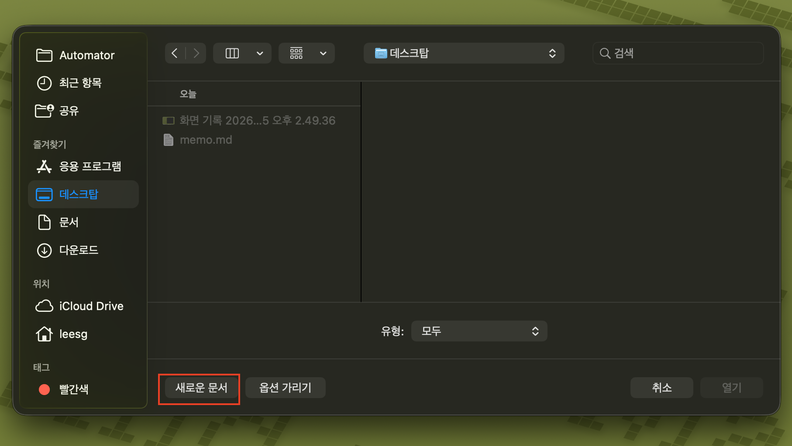
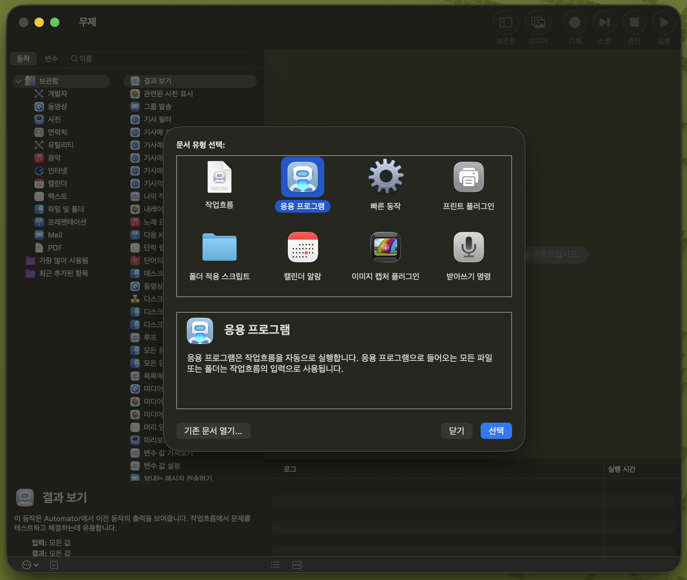
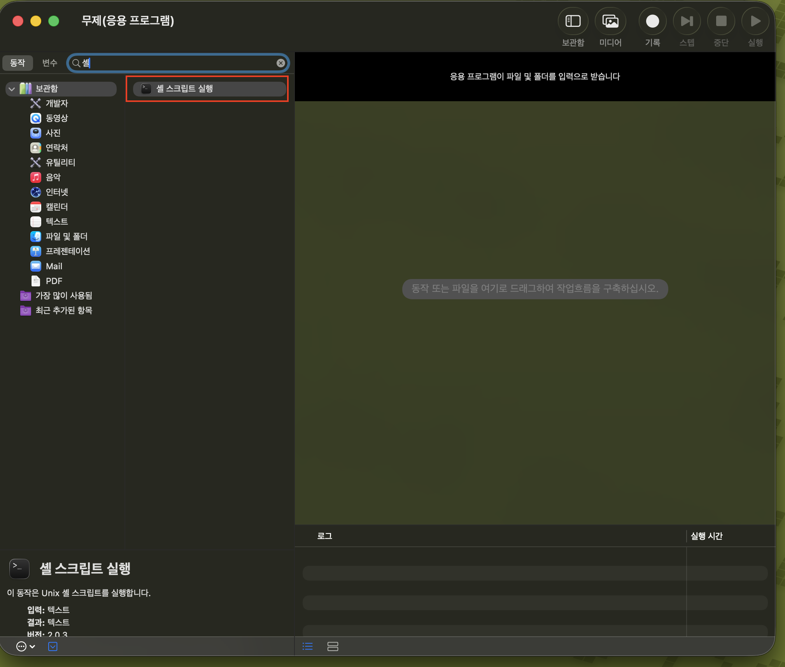
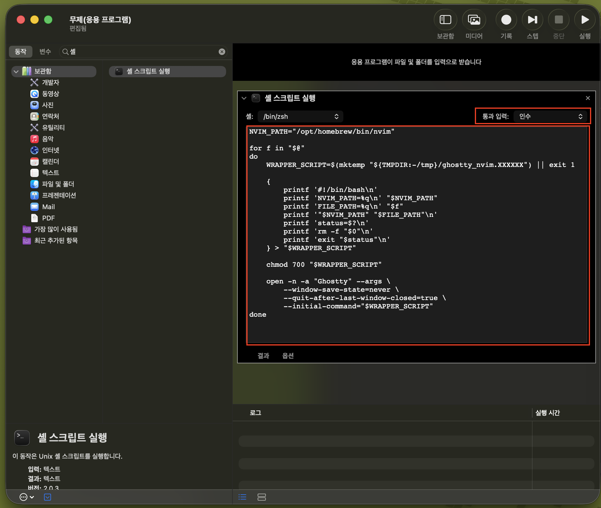
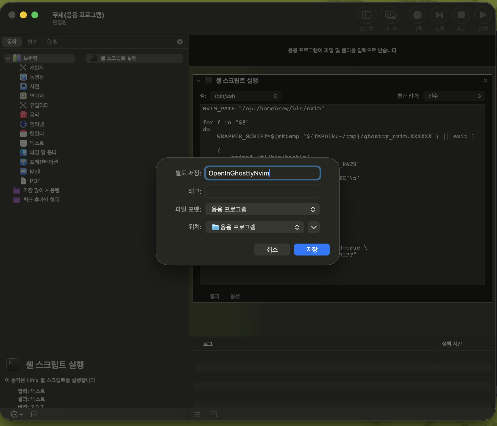
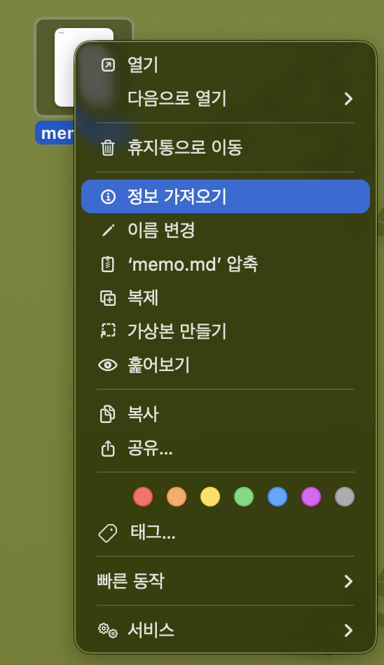
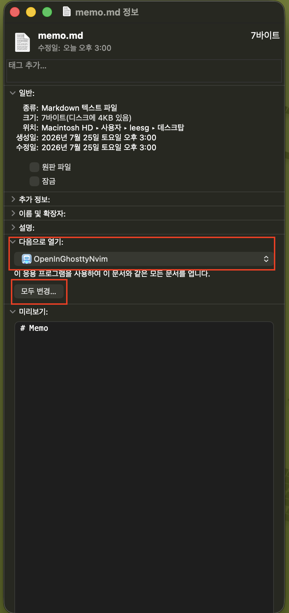
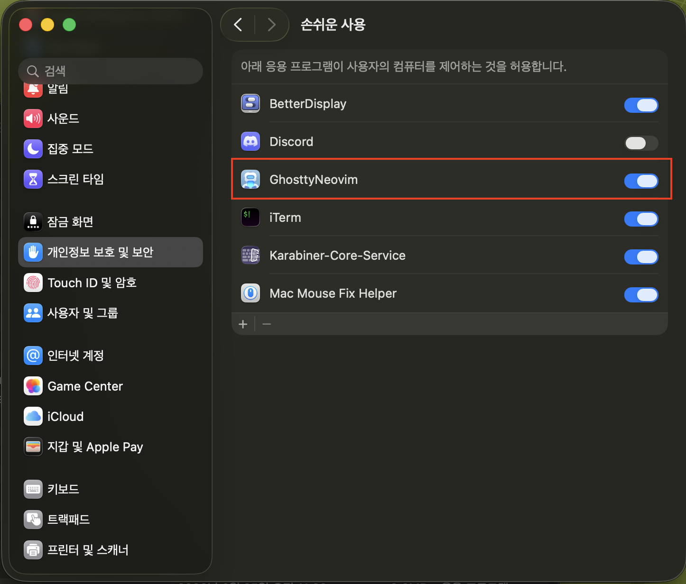

Mac OS Finder에서 파일을 더블클릭했을 때 Ghostty 터미널 + Neovim으로 열리게 하는 방법이다.

<video controls playsinline preload="metadata" style="width:100%;border-radius:8px;">
  <source src="/videos/open-file-in-ghostty-neovim/video.mp4" type="video/mp4" />
  브라우저가 video 태그를 지원하지 않습니다.
</video>

## 준비물

- Ghostty 터미널
- Neovim
- Automator (Mac OS 기본 탑재)

## 방법



먼저 Automator를 실행한 뒤 `새로운 문서`를 생성한다.



문서 유형은 응용 프로그램으로 선택한다.



왼쪽의 `동작`에서 `셸 스크립트 실행`을 선택한다.



`통과 입력`을 `인수`로 설정한 후 스크립트에 아래 내용을 복사/붙여넣기 한다.

NVIM_PATH에는 실제 Neovim 설치 경로를 입력해야 한다.

아래 명령어를 사용해서 Neovim의 설치 경로를 확인할 수 있다.

```bash
which nvim
```

```bash
NVIM_PATH="/opt/homebrew/bin/nvim"

for f in "$@"
do
    WRAPPER_SCRIPT=$(mktemp "${TMPDIR:-/tmp}/ghostty_nvim.XXXXXX") || exit 1

    {
        printf '#!/bin/bash\n'
        printf 'NVIM_PATH=%q\n' "$NVIM_PATH"
        printf 'FILE_PATH=%q\n' "$f"
        printf '"$NVIM_PATH" "$FILE_PATH"\n'
        printf 'status=$?\n'
        printf 'rm -f "$0"\n'
        printf 'exit "$status"\n'
    } > "$WRAPPER_SCRIPT"

    chmod 700 "$WRAPPER_SCRIPT"

    open -n -a "Ghostty" --args \
        --window-save-state=never \
        --quit-after-last-window-closed=true \
        --initial-command="$WRAPPER_SCRIPT"
done
```

이 스크립트는 Finder에서 선택한 파일마다 아래 과정을 수행한다.

- `mktemp`으로 임시 실행 스크립트를 만들고, `printf '%q'`로 파일 경로를 공백·특수문자까지 안전하게 기록한다.
- Ghostty를 새 창(`open -n`)으로 띄운 뒤 `--initial-command`로 그 스크립트를 실행해 Neovim으로 파일을 연다.
- Neovim을 종료하면 임시 스크립트는 스스로 삭제(`rm -f "$0"`)되고, 마지막 창이 닫히면 Ghostty도 함께 종료된다.

> `NVIM_PATH`를 절대 경로로 지정하는 이유는, GUI에서 실행되는 프로세스는 로그인 셸의 `PATH`를 물려받지 못해 `nvim`을 찾지 못할 수 있기 때문이다.



모든 과정이 완료되었다면 Cmd + S를 눌러 저장한다.

앱 이름은 적당히 지어서 입력하면 된다.

<div class="img-half">



</div>

앱이 정상적으로 생성되었다면, 이제 Ghostty + Neovim으로 열고 싶은 파일에서 앱을 `다음으로 열기`로 등록해주면 된다.

우선 해당 파일에 우클릭 + 정보 가져오기를 클릭한다.

<div class="img-half">



</div>

`다음으로 열기`에서 방금 만든 앱을 등록한 후 `모두 변경`을 눌러 같은 확장자를 가진 파일은 모두 이 앱으로 열리도록 설정한다.

이후 다른 확장자에도 같은 작업을 반복하면 된다.

## 보안 에러 발생 시



만약 보안 관련 에러가 발생하면 설정 > 개인정보 보호 및 보안 > 손쉬운 사용에서 방금 만든 앱을 추가한 후 활성화시켜준다.