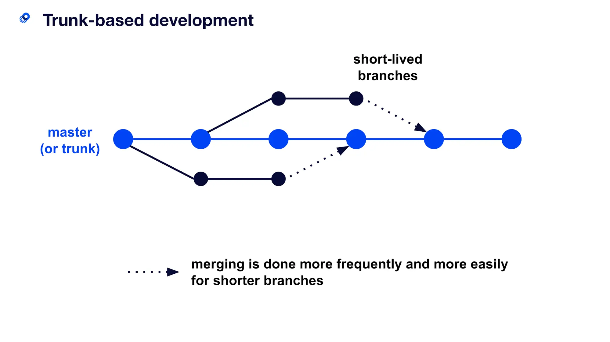
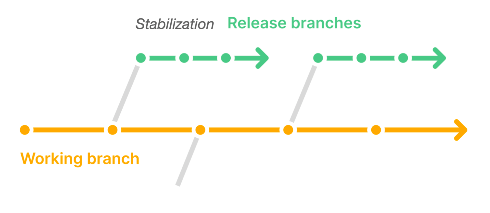
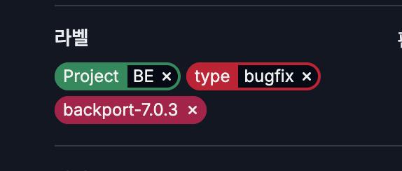
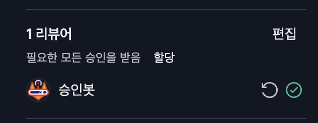
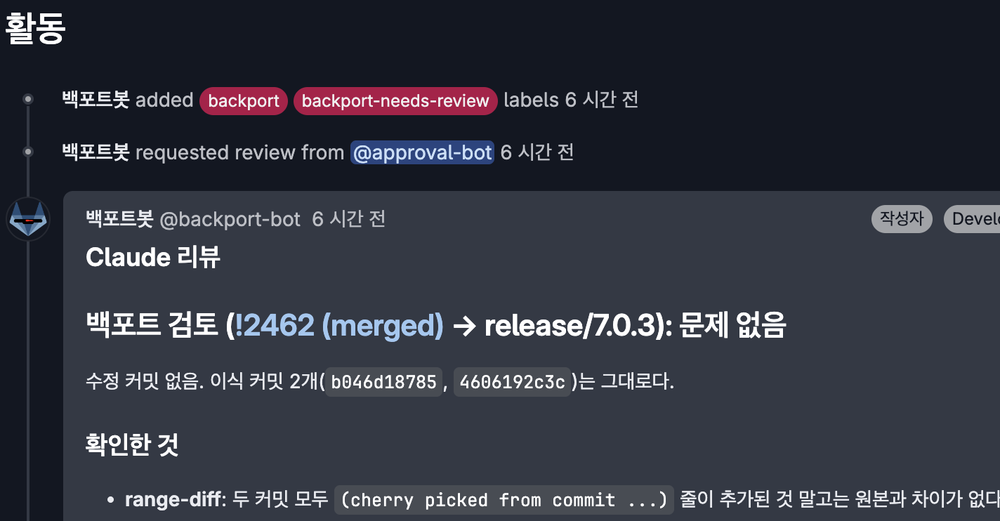

# 개요

프로젝트의 배포 유형에 알맞는 릴리즈 브랜치 전략으로 전환하고, 이에 맞추어 백포트 자동화를 구현한 방법에 대해 기록한다.

# 릴리즈 브랜치 전략

우리 팀에는 내가 합류하기 이전부터 개발하던 프로젝트가 있고, 여기에는 자체적으로 사용하던 Git 브랜치 전략이 있었다.

그것은 아주 기본적인 트렁크 기반 브랜치 전략이었다.

소스코드의 최신 상태를 가지고 있는 main 브랜치(Trunk)가 있고, 기능을 개발할 때마다 feature 브랜치를 생성해서 개발을 하는 방식으로 동작한다.

트렁크 기반 브랜치 전략은 아주 간결하고 이해하기 쉬우며 main 브랜치 외에 다른 브랜치(feature)들은 수명을 아주 짧게 가져가기 때문에 모두가 항상 같은 코드 상태를 유지하기 쉽다는 장점이 있다.

팀에서 이 브랜치 전략을 선택한 정확한 이유는 알 수 없으나, Git 브랜치 전략에 대해 조사를 하게되면 가장 많이 접하게 되는 브랜치 전략이기 때문에 선택하게 되었을거라 생각된다.

이 브랜치 전략을 사용하면서 프로젝트를 개발하는 도중에는 큰 문제가 없었으나, 프로젝트 릴리즈를 준비하면서 문제를 발견하게 되었다.

우리 프로젝트는 고객사 서버 환경에 직접 설치하는 “납품 설치형” 소프트웨어이다.

납품 설치형 소프트웨어는 고객사 서버 환경에 설치되며, 만약 버전을 업그레이드 하기 위해서는 새로운 버전의 소프트웨어를 들고 다시 고객사에 들어가서 설치를 해주어야 한다.

만약 새로 추가한 기능에서 버그가 발생했다면?

그럼 새로운 패치 버전을 들고 다시 고객사로 들어가서 … (이하 생략)

 

이러한 문제로 인해 고객사에서 이 소프트웨어를 관리하는 담당자들은 가능하면 버전을 크게 업그레이드 하지 않으려고 하는 경향이 있다.

만약 버그가 발견된 경우 버그만 수정하고 싶어하지, 최신 버전으로 업그레이드 하고 싶어하지는 않는다는 것이다.

여기서 우리 브랜치 전략에 문제가 있었다.

모든 커밋은 main 브랜치 맨 뒤에 들어가야 하는데, 버그를 수정한 뒤 패치를 하려면 고객사는 가장 최신 버전으로 업그레이드를 강제해야 하는 것이다.

여기서 깨달은 점은, 이 Trunk-based 브랜치 전략을 사용해야 하는 개발팀은 우리와 같은 납품 설치형 프로젝트가 아닌 실시간 라이브 서버를 운영하는 SaaS형 서비스를 개발하는 팀이었던 것이다.

 

그래서 우리는 이 문제를 해결하기 위해 새롭게 브랜치 전략을 적용하게 되었다.

기존에 사용하던 Trunk 기반 브랜치 전략에서 Release 브랜치를 추가하여 관리하는 Trunk based + Release branch 전략이다.

새로운 버전의 패키지가 빌드되는 시점에 릴리즈 브랜치로 분기해서 코드를 동결시키고, 이 릴리즈 브랜치에는 새로운 기능 추가 건이 담긴 커밋은 포함되지 않도록 격리한다.

이 브랜치 전략을 사용하면 고객사에서 사용하는 버전의 릴리즈 브랜치에서 버그만 수정할 수 있기 때문에 위와 같은 문제를 깔끔하게 해결할 수 있게 된다.

 

하지만 여기서 새로운 문제가 생긴다.

만약 1.1.0 버전이 출시되어서 고객사에 패치되었는데 해당 버전에서 버그가 발견된 경우를 예로 들어보자.

개발자는 이슈를 접수한 후 1.1.0 버전이 빌드될 때 분기된 release/1.1 브랜치에서 버그를 수정한 뒤 1.1.1 버전으로 패키지를 만들어서 배포한다.

그런데 만약 여기서 멈추게 되면 똑같은 버그가 이후 출시될 1.2.0 버전에서도 똑같이 발견되게 될 것이다.

`회귀 버그`가 발생하게 되는 것이다.

왜냐하면 버그는 release/1.1 브랜치에만 수정되었고, main 브랜치에는 수정이 되지 않았기 때문이다.

결국에는 main 브랜치 및 release/1.1 브랜치 모두에 버그 수정 커밋이 반영되어야 한다는 것이다.

이러한 상황에서 main 브랜치에 수정된 커밋을 release 브랜치에 똑같이 반영하는 것을 바로 “백포트”라고 한다.

현재 존재하는 많은 설치형 소프트웨어들은 위와 같거나 비슷한 브랜치 전략을 사용하고, 백포트를 통해 하위 버전에 대한 지원을 하고 있다. (예: Chrome, Nginx, Kubernetes 등)

 

우리팀은 백포트를 하기 위해 우선은 가장 직관적인 방법을 택했다.

이슈를 처리할 때 백포트를 할 모든 브랜치에 대한 MR을 만들어놓고 각 MR에 모두 같은 커밋을 푸시하며 개발하는 것이다.

개발이 완료된 이후에는 팀원의 온라인 코드 리뷰를 받아야 하는데, 이 때도 모든 MR에 대한 리뷰를 동시에 진행하고 승인이 완료된 경우에는 모든 MR에 똑같이 승인을 눌러주어야 했다.

만약 여러 MR 중 하나에서 피드백 수정 사항이 발생하는 경우 동시에 모든 MR에 그 피드백 수정 사항을 반영했다.

 

이 방법의 가장 큰 문제점은, 일단 너무 부담스럽다는 것이다.

요즘은 AI로 개발을 많이 하게 되면서 동시에 진행하는 이슈의 개수가 늘어나게 되었는데, 한 이슈마다 MR을 2~3개씩 확인하면서 코드를 리뷰하고, 승인을 누르는 것이 꽤 부담스러운 작업이었다.

또 코드 리뷰를 받는 입장에서도 한 이슈에 대해 MR을 2~3개씩 동시에 체크하고 수정 및 재 리뷰 요청하는 것도 부담이었다.

 

또 파이프라인 Job이 너무 많이 돌게되는 문제도 있었다.

현재 우리 프로젝트에는 MR에 커밋이 푸시될 때마다 테스트를 돌리는 파이프라인 Job이 있는데, MR 2~3개가 동시에 커밋/푸시되면 동시에 그 만큼의 Job이 돌게 되어 Runner가 부족해지는 현상이 발생하게 되었다.

# 백포트 자동화

나는 이 브랜치 전략을 구상하고 적용시킨 장본인으로서 책임감을 통감하고 백포트를 자동화 할 수 있는 방법이 있는지 알아보았다.

백포트를 자동으로 해주는 프로젝트가 몇 개 있기는 했으나, 보통 Github action과 라벨을 기준으로 개발되어 있었고, 막상 뜯어보면 내가(클로드와 함께) 충분히 직접 구현할 수 있어 보였다.

그래서 백포트 자동화를 직접 구현하기로 했다.

내가 구상한 백포트 자동화의 동작 방식은 아래와 같다.

1. main 브랜치의 MR에서 개발을 완료한다.
2. 2명의 팀원 리뷰를 받은 뒤 승인을 받는다. (팀 규칙)
3. MR에 사전에 정해둔 backport 라벨을 붙이고 머지한다.
4. 머지가 완료된 경우 GitLab Runner job에서 자동으로 백포트 MR을 만들고 백포트를 진행한다.
5. 백포트 MR은 승인 봇이 승인하거나, 개발자 본인이 직접 승인 후 머지한다. 혹은 선택적으로 팀원의 리뷰를 받아도 좋다.

여기서 중요한 점은 백포트 할 브랜치가 아무리 많더라도 개발 및 리뷰는 main 브랜치 하나에서만 진행한다는 것이다.

개발자 및 리뷰어들이 같은 내용의 이슈에 대해 하나 이상의 MR을 보지 않게 하려는게 주된 목적이었기 때문이다.

 

백포트 자동화 프로세스 중 실제로 백포트를 실행하는 것은 GitLab Runner에서 동작하는 Shell script인데, 아래와 같은 로직으로 구성되어 있다.

1. `git cherry-pick -x` 명령어를 사용해 main 브랜치의 커밋들을 체리픽하고 MR을 만들어 push 한다.
2. 백포트 커밋이 “완전 무결”한 경우에는 사전에 만들어 놓은 "승인 봇"이 승인을 누른다.
3. 만약 “완전 무결”하지 않은 경우에는 승인이 눌러지지 않은 채로 MR이 만들어지므로 개발자가 한 번 더 확인을 한 뒤 승인을 누른다.
4. cherry-pick 도중 충돌이 발생한 경우에는 빈 MR만 만들고 본문에 cherry-pick 충돌에 대한 정보를 기록한다. 이후 개발자가 수동으로 충돌을 해결하고 체리픽 커밋을 push한다.

 

여기서 “완전 무결”의 조건은 아래와 같다.

- 모든 파일이 생성 및 삭제되지 않음
- 위험 경로의 파일을 수정하지 않음 (사전에 .gitlab-ci.yml에 정의)
- 원본과 변겅 내용이 완전히 같음
- 원본 MR이 2명의 승인을 받고 머지됨

이렇게 백포트 자동화를 적용을 완료하였고, 들의 백포트 부담이 크게 감소하게 되었다.

그와 동시에 사람이 확인해야 할 MR이 줄어드니 개발 프로세스도 더 빨라지게 되었다.

# AI 백포트 자동화

위와 같이 백포트 자동화를 구성하고 나서 몇 일 돌려보니 팀원들의 행동에 공통점이 하나 발견되었다.

바로 승인 봇이 승인을 눌러주지 않은 MR(완전 무결하지 않거나 충돌이 발생)에 대해서는 하나같이 Claude code를 열고 “백포트 검토해줘” 혹은 “백포트 진행해줘”와 같은 작업을 진행한다는 것이었다.

나는 이 과정까지도 자동화의 일부로 포함시키면 좋을 것 같다는 생각이 들었다.

그래서 바로 백포트 Job이 실행될 때 컨테이너 내부에서 Claude code를 설치한 후 사전 입력된 프롬프트를 실행하도록 구성해보았다.

정확히는 승인 봇이 승인을 누르지 않은 경우에는 Claude가 리뷰를 해주고, 체리픽 도중 충돌이 발생해서 빈 MR이 되었을 때에는 Claude가 백포트 진행 및 리뷰까지 진행하도록 하였다.

결과는 매우 좋았다.

팀원들은 백포트에 대해서 거의 신경을 쓰지 않아도 될 정도로 완성도 있게 백포트가 되었으며, 백포트에 대한 부담도 거의 없다시피 하게 되었다.

드디어 팀원들이 완벽하게 main 브랜치에서만 개발을 할 수 있게 된것이다.

 

하지만 이 시스템을 개발한 내 입장에서 아주 약간의 걱정거리가 생기게 되었는데, 개발자들이 백포트에 거의 신경을 쓰지 않게 되면서 아주 적은 가능성이지만 버그가 숨어들어도 아무도 알 수 없게 되었다는 점이다.

물론 현재는 백포트 지원 버전을 적당히 유지함으로써 백포트하는 브랜치가 main 브랜치의 차이가 크지 않기 때문에 커밋에는 큰 차이가 없고, 또 QA에서 한 번 더 검증을 거치기 때문에 문제가 없을 거라고 생각한다.

그래도 나는 당분간 이 체계를 유지해나가면서 위와 같은 문제에 대해 모니터링하고 계속 개선점을 찾아내야 할 것 같다.

 

끝